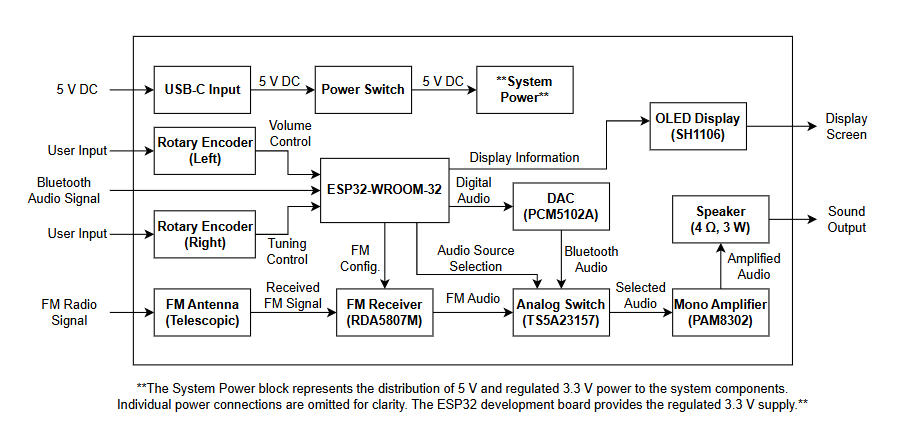

# System Design

## Overview

The Bluetooth/FM radio is a mono tabletop audio system controlled by an ESP32-WROOM-32
microcontroller. The ESP32 handles Bluetooth audio reception, FM radio configuration, user
input, display updates, and audio source selection.

Bluetooth and FM audio use separate signal paths before being routed through a shared analog 
switch, mono amplifier, and speaker.

## System Block Diagram

This block diagram illustrates the major hardware subsystems and their functional connections.
The ESP32 coordinates Bluetooth audio reception, FM tuning, user input, display updates, and
audio source selection. Both audio sources share a mono amplifier and speaker. 

## Main Subsystems

- **Microcontroller:** ESP32-WROOM-32 development board responsible for Bluetooth 
communication, audio processing, user interface, and peripheral control.
- **Bluetooth audio:** Receives audio from a paired smartphone using Bluetooth Classic A2DP 
and converts stereo audio to mono.
- **FM receiver:** RDA5807M module receives FM broadcasts through a telescopic antenna and 
provides a mono analog audio signal.
- **Audio circuitry:** PCM5102A DAC converts Bluetooth audio to analog, TS5A23157 selects the 
active audio source, and PAM8302 amplifies the selected signal.
- **User interface:** Two KY-040 rotary encoders provide volume, tuning, and button controls. 
A 1.3-inch SH1106 OLED displays operating information.
- **Power:** External 5 V USB-C input with a physical power switch. The ESP32 development 
board's onboard regulator is intended to supply the 3.3 V peripherals.
- **Enclosure:** Custom 3D-printed retro-style enclosure housing the electronics, speaker, 
display, rotary encoders, and antenna.

## Audio Architecture

The system uses analog audio switching to route Bluetooth and FM audio through a shared mono 
amplifier and speaker.

**Bluetooth Audio Path**

1. The ESP32 receives stereo audio from a paired smartphone using Bluetooth Classic A2DP.
2. The firmware downmixes the stereo audio into a mono digital signal.
3. The PCM5102A DAC converts the digital audio into an analog signal.
4. The analog signal passes through the TS5A23157 audio switch.

**FM Audio Path**

1. The telescopic antenna receives FM radio signals.
2. The RDA5807M receiver tunes to the selected frequency and operates in forced mono mode.
3. The receiver provides a mono analog audio signal to the TS5A23157 audio switch.

**Shared Audio Output**

The ESP32 controls the TS5A23157 to select either Bluetooth or FM audio. The selected signal 
is sent to the PAM8302 mono amplifier, which drives a single 2-inch, 4 Ω, 3 W speaker.

Volume is controlled digitally for Bluetooth audio and through the RDA5807M's internal volume 
control for FM reception.

## User Interface

The system uses two rotary encoders with integrated pushbuttons and an SH1106 OLED display.

| Control | Rotation | Pushbutton |
|---|---|---|
| Left rotary encoder | Volume adjustment | Play/pause |
| Right rotary encoder | FM frequency tuning | Bluetooth/FM mode selection |

The OLED displays information such as the active operating mode, FM frequency, Bluetooth 
connection status, and volume level.

## Power Architecture

The radio receives external 5 V DC power through a USB-C breakout board. A rear-mounted 
rocker switch controls system power.

The 5 V supply powers the ESP32 development board and PAM8302 amplifier. The ESP32 
development board's onboard regulator is intended to provide regulated 3.3 V power to the 
remaining peripherals.

Individual power connections are omitted from the system block diagram for clarity. Power 
distribution, decoupling, and regulator capacity will be verified during schematic 
development and hardware testing.

## Firmware Architecture

Firmware will be developed in C using ESP-IDF and FreeRTOS.

Separate software modules will handle:

- Bluetooth A2DP reception and mono audio processing
- FM receiver configuration and frequency tuning
- Audio source selection and volume control
- Rotary encoder input and button handling
- OLED display updates
- Persistent settings storage

The firmware will support switching between Bluetooth and FM modes, updating the display, and 
responding to user controls.

## PCB and Enclosure Design

The system will use a custom two-layer carrier PCB to integrate the ESP32 development board 
and selected peripheral modules.

The PCB will provide connections for the audio circuitry, display, rotary encoders, antenna, 
speaker, and power input.

A custom 3D-printed enclosure will feature a dark retro appearance, front-mounted speaker 
grille, OLED display, and two rotary knobs. The USB-C power input, rocker switch, and 
telescopic antenna will be mounted on the rear.